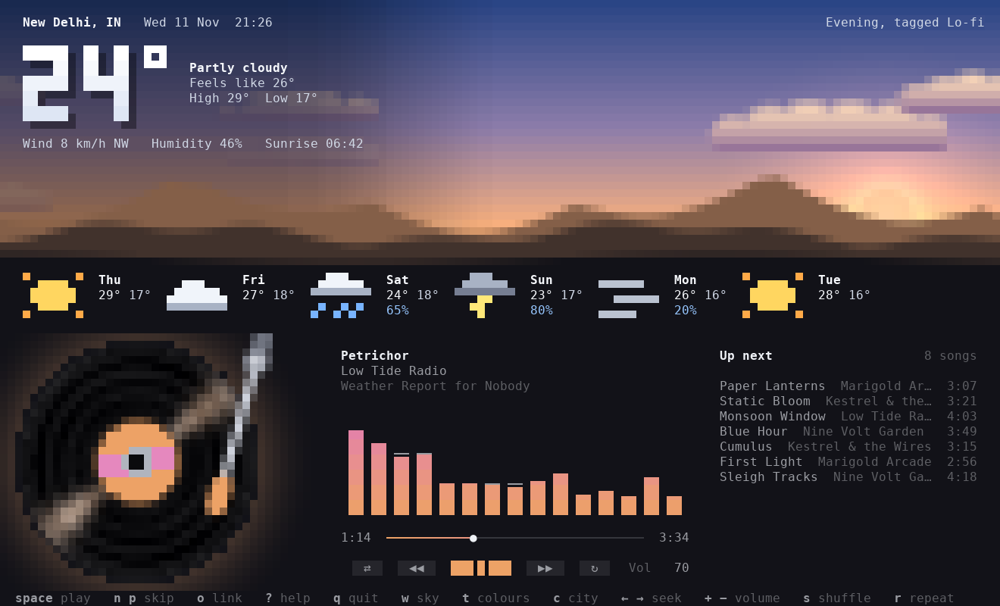
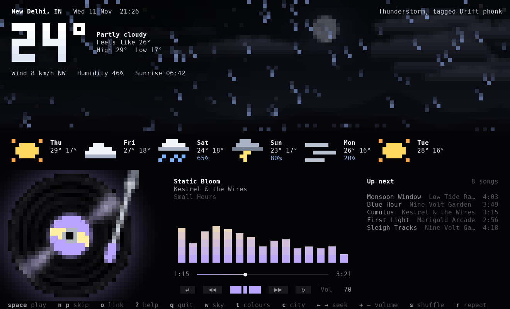
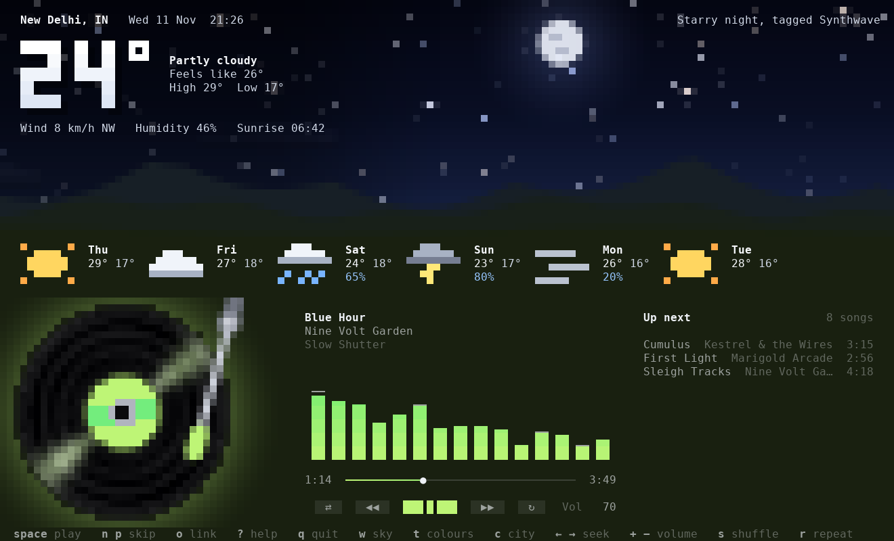

# Cloudspin

A music player for your terminal that lives under a sky. A record spins, the
weather for your city is written across the horizon, and the sky itself changes
with the song: phonk brings a thunderstorm, lo-fi settles into evening,
synthwave turns the stars on.



| Phonk gets a storm | Synthwave gets the night, in the cover's colours |
| --- | --- |
|  |  |

## What it does

- Plays local files, folders, radio streams and links through `mpv`.
- Opens YouTube, YouTube Music and Spotify playlists as a queue.
- Paste a link or a playlist while it's running (press `o`) and it starts playing.
- Shows live weather and a six-day forecast from [Open-Meteo](https://open-meteo.com) (free, no API key).
- Draws an animated sky: sun, moon with the real phase, stars, drifting clouds, rain, snow, fog and lightning.
- Picks the sky to suit the song, or follows the real weather, or stays on a scene you pin.
- Takes its colours from the sky, from the song's cover art, or from a theme you write.
- Spins a record whose label is the album cover, with a tonearm that tracks through the song.
- Works with the mouse: click the buttons, drag the progress line, click a song in Up next, scroll for volume.

## Install

Pick whichever you already have:

```sh
pipx install cloudspin        # Python
uv tool install cloudspin     # uv
npm install -g cloudspin      # npm (a launcher; it runs the Python app through uv or pipx)
```

Or try it without installing: `uvx cloudspin --demo` or `npx cloudspin --demo`.

Works on Linux, macOS and Windows, with Python 3.11 or newer and a truecolor
terminal (Windows Terminal, kitty, foot, Alacritty, WezTerm, Ghostty, iTerm2
and most others).

### What comes with it

| Tool | What it's for | How you get it |
| --- | --- | --- |
| `yt-dlp` | YouTube, SoundCloud and similar links | Installed with Cloudspin |
| `mpv` | Plays the sound | **Windows:** downloaded automatically the first time you start Cloudspin (about 30 MB, kept in its cache folder). **Linux and macOS:** from your package manager, e.g. `sudo pacman -S mpv`, `sudo apt install mpv`, `brew install mpv` |

Without mpv Cloudspin still runs, silently, and tells you the command to install it.

## Use

```sh
cloudspin                       # plays ~/Music
cloudspin ~/Music/phonk         # a folder
cloudspin song.flac other.mp3   # files
cloudspin https://example.com/stream.mp3   # a link
cloudspin "https://music.youtube.com/playlist?list=..."   # a YouTube Music playlist
cloudspin "https://open.spotify.com/playlist/..."        # a Spotify playlist
cloudspin --city "New Delhi"    # set the city once; it is remembered
cloudspin --demo                # look around without any music or sound
```

No music folder? Start `cloudspin`, press `o` and paste a link.

### Keys

| Key | Does |
| --- | --- |
| `space` | Play or pause |
| `n` `p` | Next song, previous song |
| `←` `→` | Skip 5 seconds (`Shift` for 30) |
| `+` `-` | Volume |
| `s` | Shuffle |
| `r` | Repeat: off, all, one |
| `o` | Open a link, file or folder and play it |
| `w` | Sky: follow the song, follow the weather, or pin a scene |
| `t` | Colours: follow the sky, follow the cover art, or a theme |
| `c` | Choose the city |
| `u` | Switch °C and °F |
| `?` | Show the keys |
| `q` | Quit |

## Playlists

Paste a playlist link with `o`, pass it on the command line, or set it as
`music` in the settings so Cloudspin opens with it every time.

- **YouTube, YouTube Music, SoundCloud** and other sites yt-dlp knows play
  straight from the site.
- **Spotify** works differently. Spotify's audio only plays inside its own
  apps, so Cloudspin reads the list of songs from the public playlist page and
  plays each one from the closest match on YouTube. Usually that is the same
  recording; now and then it is a live or alternate version. The playlist has
  to be public, and long ones are read up to the first 50 to 100 songs.

## How the sky picks a scene

With the sky set to follow the song (the default), Cloudspin decides like this:

1. **Your rules.** Words you map to scenes in the config file always win.
2. **How the song sounds.** Thirty seconds are decoded in the background and
   measured for rhythm (attacks per second, tempo), brightness, bass weight
   and loudness. Busy, bright and bass-heavy becomes a storm; slow and soft
   becomes evening or night. This works for links as well as files, and each
   song is only measured once.
3. **The words**, as a first guess while the listening happens and as the
   answer when listening isn't possible: the genre tag, then sky words in the
   title or album. `phonk`, `hoodtrap` and `metal` storm; `lofi` and `jazz`
   get the evening; `synthwave` gets the night; "Midnight Rain" needs no tag.
4. **The real weather**, if nothing above says anything.

The caption in the top right corner of the sky always says which scene is
showing and why, for example `Thunderstorm, hard-hitting and heavy on bass`.

To see what Cloudspin hears in a song, and report one it gets wrong:

```sh
cloudspin --listen "song.mp3"
```

The scenes are `storm`, `rain`, `evening`, `night`, `day`, `dawn`, `snow`,
`fog` and `overcast`.

## Settings

Settings live in `~/.config/cloudspin/config.toml`. Everything is optional.

```toml
city = "New Delhi"
units = "metric"      # or "imperial"
sky = "song"          # "song", "weather", or a scene name to pin
colors = "sky"        # "sky", "cover", a built-in theme, or one of yours
music = "~/Music"     # a folder, or a playlist link
volume = 70
fps = 24              # lower this on a slow terminal or over SSH
listen = true         # false: choose the sky from tags and titles only

# Send particular artists, albums or words to a scene.
[moods]
"kordhell" = "storm"
"study mix" = "evening"

# Your own colours. Only `accent` is required.
[themes.neon]
accent = "#39ff88"
accent2 = "#00c2ff"
background = "#07100c"
disc = "#39ff88"      # the record label, when the song has no cover art
disc2 = "#ffffff"
```

Built-in themes: `sky`, `cover`, `amber`, `orchid`, `lagoon`, `moss`, `rose`, `mono`.

## Good to know

- **The bars are generative.** The spectrum moves with the play state, the
  volume and a tempo chosen per song. It is not a live analysis of the audio.
- **The listening is a rule of thumb.** It has been checked against synthetic
  test audio, not a real music library, so expect some wrong skies. Use
  `[moods]` to pin an artist or word to a scene, and `cloudspin --listen` to
  see the numbers behind a choice.
- **Links** play through mpv, with the bundled yt-dlp handling sites like
  YouTube. Sites change often; if a link stops working, update with
  `pipx upgrade cloudspin` (or `uv tool upgrade cloudspin`) to get a newer yt-dlp.
- **Windows** uses the mpv that Cloudspin downloads for itself unless `mpv` is
  already on your PATH.
- **MPRIS** (media keys, `playerctl`, Waybar) works on Linux if you have the
  `mpv-mpris` plugin installed for mpv; Cloudspin loads your normal mpv config.

## Releases

| Channel | Status |
| --- | --- |
| [PyPI](https://pypi.org/project/cloudspin/) | Published |
| [npm](https://www.npmjs.com/package/cloudspin) | Published (launcher for the Python app) |
| AUR | `packaging/aur/PKGBUILD` is written, not submitted yet |
| Homebrew | Not started |

Pushing a `v*` tag runs `.github/workflows/release.yml`, which tests, then
publishes to PyPI and npm.

## Develop

```sh
git clone https://github.com/itsHarshDabas/Cloudspin && cd Cloudspin
python -m venv .venv && . .venv/bin/activate
pip install -e ".[dev]"
pytest
python scripts/screenshot.py out.png --song 2   # render the app to a PNG, no terminal needed
```

The code is small and split by job:

| File | Job |
| --- | --- |
| `sky.py` | The procedural sky and landscape |
| `canvas.py` | Half-block pixel drawing |
| `vinyl.py`, `spectrum.py` | The record and the bars |
| `mood.py` | Choosing a scene for a song |
| `weather.py` | Open-Meteo and sun and moon maths |
| `player.py` | mpv control and the queue |
| `links.py` | Reading YouTube and Spotify playlists |
| `mpvget.py` | Finding mpv and yt-dlp; the Windows mpv download |
| `widgets.py`, `app.py` | The interface |

## Licence

MIT
